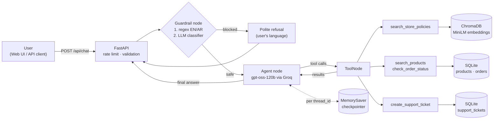

# 👜 Haqiba Bags: AI Customer Support & Operations Agent

A production-style, bilingual (English / Egyptian Arabic) customer support agent for an e-commerce bag store.
It answers policy questions with RAG, looks up live products and orders in SQLite, escalates frustrated customers
to a human by opening a support ticket, and blocks prompt-injection and off-topic abuse **before** the main LLM runs.
It ships with an automated evaluation suite, a FastAPI backend, a demo web UI and a Docker image.


> **Demo screenshot:** add `docs/screenshot.png` and it will render here.
>
> ``

---

## ✨ Engineering highlights

| | |
|---|---|
| **Stateful ReAct agent** | LangGraph `StateGraph` with an agent ⇄ tools loop, per-conversation memory (`thread_id` + checkpointer), history trimming that never splits a tool call from its result, and a recursion limit against runaway tool loops. |
| **Two-stage input guardrail** | A deterministic EN/AR regex filter (with Unicode / zero-width / Arabic-diacritic normalisation) followed by a small LLM classifier with **structured output**. Blocked turns never reach the main model, and the injected text is **redacted from memory** so it can't resurface on later turns. |
| **Grounded answers, no hallucinated policies** | RAG over the store's policy document (header-aware chunking with section breadcrumbs, local MiniLM embeddings, cosine-similarity threshold). When nothing relevant is found, the tool tells the LLM explicitly *not* to guess. |
| **Safe tool layer** | 4 tools with strict Pydantic `args_schema`s, parameterised SQL only (LIKE wildcards escaped), input normalisation (`" ord-1004 "` → `ORD-1004`), and errors returned as text so the agent can recover instead of crashing. |
| **Human handoff** | `create_support_ticket` with priority-based SLAs; tickets are visible live at `GET /api/tickets` and in the UI's ticket drawer. |
| **Automated evals** | 12 bilingual test cases measuring **tool-routing accuracy, guardrail accuracy (FP/FN), LLM-as-a-judge faithfulness & helpfulness, and latency**, exported to JSON with a CI-friendly exit code. |
| **Deployable** | FastAPI with a self-healing startup (re-seeds / re-indexes on ephemeral hosts), per-IP rate limiting, a CPU-only Docker image with the model and index baked in, health checks, and a non-root user. |

---

## 🏗️ Architecture



**One request, step by step**

1. The UI sends `{message, thread_id}` to `POST /api/chat`. FastAPI validates it (1–1000 chars) and applies the per-IP rate limit.
2. **Guardrail node**: the length check, then regex, then (for messages longer than 3 words) the LLM classifier, which gets the previous assistant message as context. If it blocks, the user's message is redacted in memory, a refusal is returned and the graph ends. The main LLM and the tools are never invoked.
3. **Agent node**: the system prompt (with the current Cairo time) plus the trimmed history go to the LLM with the 4 tools bound.
4. **Tools node**: executes the tool calls, and the results loop back to the agent until it produces a final answer.
5. The API returns `reply`, `tools_used`, `guardrail_blocked` and `latency_ms`, which the UI shows as telemetry badges.

---

## 🧰 Tech stack

| Layer | Technology | Why |
|---|---|---|
| Agent orchestration | **LangGraph** (`StateGraph`, `ToolNode`, `tools_condition`, `MemorySaver`) | Explicit, inspectable control flow; easy to add nodes like the guardrail |
| LLMs | **Groq**: `openai/gpt-oss-120b` (agent, judge), `openai/gpt-oss-20b` (guardrail) | Very low latency; all configurable via `.env` |
| Tools & schemas | **LangChain Core** `@tool` + **Pydantic v2** | Strict, LLM-readable input validation |
| RAG | **ChromaDB** + `sentence-transformers/all-MiniLM-L6-v2` + `RecursiveCharacterTextSplitter` | Free, local embeddings; persistent vector store |
| Operational data | **SQLite** (WAL mode, CHECK constraints, indexes) | Zero-ops, transactional, and plenty for a demo store |
| API | **FastAPI** + Uvicorn | Typed endpoints, OpenAPI docs at `/docs` |
| Frontend | Single-file **HTML + Tailwind (CDN) + vanilla JS** | No build step; bilingual with automatic RTL |
| Evaluation | Custom runner + **LLM-as-a-judge** (structured output) | Routing, guardrail, faithfulness, helpfulness, latency |
| Deployment | **Docker** (`python:3.11-slim`, CPU-only PyTorch) | Small image, non-root, health-checked |

---

## 📁 Project structure

```
.
├── app/
│   ├── agent/
│   │   ├── graph.py          # LangGraph workflow, chat_with_agent(), CLI chat
│   │   ├── guardrails.py     # Regex + LLM input guardrail
│   │   ├── prompts.py        # System prompt
│   │   ├── state.py          # AgentState
│   │   └── tools.py          # 4 tools with Pydantic schemas
│   ├── api/
│   │   ├── main.py           # FastAPI app (lifespan, CORS, rate limit, endpoints)
│   │   └── schemas.py        # Request/response models
│   ├── db/
│   │   ├── database.py       # SQLite connection manager + schema
│   │   └── seed.py           # Sample products & orders (with edge cases)
│   └── rag/
│       ├── config.py         # Shared paths, embedding model, Chroma settings
│       ├── ingest.py         # Markdown → chunks → Chroma
│       └── retriever.py      # retrieve_policies() with relevance threshold
├── data/store_policies.md    # Knowledge base: shipping, returns, warranty, payments, escalation
├── evals/
│   ├── test_dataset.json     # 12 bilingual test cases
│   └── run_evals.py          # Evaluation runner → evals/eval_report.json
├── frontend/index.html       # Demo chat UI
├── Dockerfile
└── requirements.txt
```

---

## 🔧 Agent tools

| Tool | Purpose | Data source |
|---|---|---|
| `search_store_policies(query)` | Shipping, returns, refunds, warranty, payments, hours, escalation | ChromaDB (RAG) |
| `search_products(query, max_price?)` | Catalogue search with explicit `In Stock (N left)` / `Out of Stock` | SQLite `products` |
| `check_order_status(order_id)` | Live status, tracking number, total; agent-facing notes per status | SQLite `orders` |
| `create_support_ticket(customer_name, issue_summary, order_id?, priority)` | Human handoff with `low/medium/high/urgent` priority | SQLite `support_tickets` |

The seed data includes deliberate edge cases: out-of-stock and low-stock products, two **delayed** orders (`ORD-1004` stuck in transit, `ORD-1005` delayed before dispatch), and cancelled, returned and pending orders.

---

## 📊 Evaluation benchmark

`python -m evals.run_evals` runs 12 cases (6 English, 6 Arabic) across policy RAG, product search, order tracking,
escalation, and guardrail attacks. Each case uses an isolated `thread_id`.

| Metric | What it measures | Result |
|---|---|---|
| Tool Routing Accuracy | Every expected tool was called (no tools for blocked cases) | **_TBD_** % |
| Guardrail Accuracy | Blocked exactly when expected | **_TBD_** % (FP: _TBD_, FN: _TBD_) |
| Avg Faithfulness (1–5) | Reply facts are supported by the tool outputs (LLM judge) | **_TBD_** |
| Avg Helpfulness (1–5) | Reply matches the expected behaviour, in the customer's language (LLM judge) | **_TBD_** |
| Avg Latency | End-to-end seconds per turn (guardrail + agent + tools) | **_TBD_** s |

> Fill this table from the `summary` block of `evals/eval_report.json` after a run.
> Models: agent `gpt-oss-120b`, guardrail `gpt-oss-20b`, judge `gpt-oss-120b` (all on Groq).
> Because the agent and the judge are the same model, faithfulness scores may be slightly lenient.

---

## 🚀 Quick start (local)

**Prerequisites:** Python 3.11+ and a free [Groq API key](https://console.groq.com/keys).

```bash
# 1. Create a virtual environment and install dependencies
python -m venv .venv
# Windows:
.venv\Scripts\activate
# macOS / Linux:
source .venv/bin/activate
pip install -r requirements.txt

# 2. Configure secrets
cp .env.example .env          # Windows: copy .env.example .env
#    then set GROQ_API_KEY in .env

# 3. Build the data (optional: the API does this automatically on first start)
python -m app.db.seed
python -m app.rag.ingest

# 4. Run the API + web UI
uvicorn app.api.main:app --reload --port 8000
```

Open **http://localhost:8000** for the chat UI, or **http://localhost:8000/docs** for the interactive API docs.
The first start downloads the embedding model (~90 MB) once.

**Other entry points**

```bash
python -m app.agent.graph        # interactive terminal chat
python -m app.agent.guardrails   # guardrail self-test (regex-only without an API key)
python -m app.rag.retriever      # sample retrieval queries with relevance scores
python -m app.agent.tools        # invoke each tool directly
```

---

## 🧪 Running the evaluation suite

```bash
python -m evals.run_evals                      # full run with LLM judge
python -m evals.run_evals --no-judge           # routing / guardrail / latency only
python -m evals.run_evals --ids guardrail_en_injection order_en_shipped
python -m evals.run_evals --delay 5            # slower, kinder to Groq free-tier rate limits
```

The runner re-seeds the database first, prints a per-case table plus a summary, writes `evals/eval_report.json`,
and exits with code `1` if any routing or guardrail check fails, so it can gate a CI pipeline.

---

## 🐳 Docker

```bash
docker build -t haqiba-agent .
docker run --rm -p 8000:8000 --env-file .env haqiba-agent
```

The image installs CPU-only PyTorch, bakes in the embedding model, the seeded database and the vector index,
runs as a non-root user, and has a `HEALTHCHECK` on `/health`. It honours a `PORT` environment variable for platforms like Render.

---

## 🔌 API reference

| Method | Path | Description |
|---|---|---|
| `GET` | `/` | Demo chat UI |
| `GET` | `/health` | `{"status": "healthy"}` |
| `POST` | `/api/chat` | Send a message; returns reply + telemetry |
| `GET` | `/api/tickets` | All support tickets, newest first |
| `GET` | `/docs` | OpenAPI / Swagger UI |

```bash
curl -X POST http://localhost:8000/api/chat \
  -H "Content-Type: application/json" \
  -d '{"message": "Where is my order ORD-1002? My name is Mona Khaled.", "thread_id": "demo-1"}'
```

```json
{
  "reply": "Your order ORD-1002 (Classic Leather Tote) has shipped. Tracking number: EGX223344556 ...",
  "tools_used": ["check_order_status"],
  "guardrail_blocked": false,
  "latency_ms": 1840.3
}
```

---

## ⚙️ Configuration

| Variable | Default | Description |
|---|---|---|
| `GROQ_API_KEY` | *(required)* | Groq API key |
| `GROQ_MODEL` | `openai/gpt-oss-120b` | Main agent model |
| `GUARDRAIL_MODEL` | `openai/gpt-oss-20b` | Guardrail classifier model |
| `EVAL_JUDGE_MODEL` | `openai/gpt-oss-120b` | LLM-as-a-judge model |
| `EMBEDDING_MODEL` | `sentence-transformers/all-MiniLM-L6-v2` | Re-run ingestion after changing it |
| `RATE_LIMIT_PER_MINUTE` | `20` | Per-IP limit on `/api/chat` (`0` disables) |
| `CORS_ORIGINS` | `*` | Comma-separated allowed origins |
| `LANGCHAIN_TRACING_V2` / `LANGCHAIN_API_KEY` | `false` | Optional LangSmith tracing |

---

## 🧭 Design decisions & trade-offs

- **Guardrail fails open.** If the classifier errors, the message passes: the regex stage has already run, and the agent's system prompt still restricts it. Failing closed would block every customer during a provider hiccup.
- **Frustration is not abuse.** The classifier is told that complaints and rude language about an order are *safe*, so angry customers get escalated rather than refused.
- **LLM-written refusals are sanity-checked** (length, language, no links) and fall back to fixed bilingual templates, so an injected prompt can't make the refusal say arbitrary things.
- **English tool queries.** The agent translates Arabic questions into English before searching, because the embedding model and catalogue are English. A multilingual embedding model is a one-line `.env` change.
- **`llama-3.3-70b-versatile` → `gpt-oss-120b`.** Groq shut down the Llama 3.x models in August 2026, so all model IDs are configuration, not code.

## 🗺️ Limitations & roadmap

- `MemorySaver` keeps conversations in RAM (lost on restart, single process). Next step: `SqliteSaver` / `PostgresSaver`.
- The order-ownership check (name must match the order) is enforced by the prompt; a stronger version moves it into the tool.
- The rate limiter is in-memory and per process; behind several replicas, use Redis.
- `GET /api/tickets` is public for demo purposes; in production it belongs behind authentication.
- Streaming responses (SSE) and a Postgres-backed product catalogue are natural next steps.
